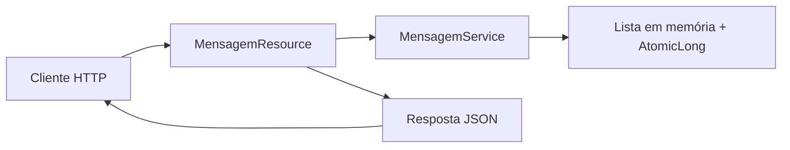

# Mensagens REST com Quarkus

**Crie, consulte e remova mensagens para entender a comunicação HTTP entre cliente e servidor.**

Projeto acadêmico de Sistemas Distribuídos com Quarkus, Java e JSON. A aplicação mostra como um recurso REST recebe dados, delega a lógica a um serviço e devolve respostas com códigos HTTP e cabeçalho `Location`.

> O termo mensageria aqui descreve a troca de requisições e respostas. Não há broker, fila, processamento assíncrono ou entrega de mensagens entre usuários.

[Executar](#executar) · [API](#api) · [Arquitetura](#arquitetura) · [Testes](#testes-e-evidências) · [Referências](#referências)

## Executar

Prepare **JDK 21**. O Maven Wrapper está incluído, dispensando uma instalação global do Maven.

```bash
git clone https://github.com/dlr-1337/quarkus-mensageria-distribuida.git
cd quarkus-mensageria-distribuida
# Linux/macOS
sh mvnw quarkus:dev
```

No Windows:

```powershell
.\mvnw.cmd quarkus:dev
```

A API fica em **http://localhost:8080/mensagens**. Não é necessário configurar banco ou autenticação para a demonstração local.

## API

| Método | Endpoint | Sucesso | Registro inexistente |
| --- | --- | --- | --- |
| `GET` | `/mensagens` | `200` com a lista, inclusive vazia. | — |
| `GET` | `/mensagens/{id}` | `200` com a mensagem. | `404` |
| `POST` | `/mensagens` | `201`, JSON e `Location` do recurso criado. | — |
| `DELETE` | `/mensagens/{id}` | `200` com a mensagem removida. | `404` |

Crie uma mensagem de teste:

```bash
curl -i -X POST http://localhost:8080/mensagens \
  -H 'Content-Type: application/json' \
  -d '{"remetente":"Exemplo","conteudo":"Minha primeira mensagem"}'
```

Use o ID retornado para consultar ou remover o registro:

```bash
curl http://localhost:8080/mensagens
curl http://localhost:8080/mensagens/1
curl -i -X DELETE http://localhost:8080/mensagens/1
```

O recurso `Mensagem` contém `id`, `remetente`, `conteudo` e `timestamp`. ID e data/hora são gerados pelo servidor; remetente e conteúdo vêm do cliente.

## Arquitetura



**Quarkus REST + Jackson** trata o contrato HTTP/JSON. `MensagemResource` concentra rotas e respostas, enquanto `MensagemService` organiza as operações e o armazenamento com `CopyOnWriteArrayList`. `AtomicLong` gera os identificadores.

Os dados desaparecem quando o processo reinicia. A estrutura em memória mantém o foco no exercício; não deve ser tratada como persistência durável ou solução de mensageria para produção.

| Diretório | Conteúdo |
| --- | --- |
| `src/main/java/br/com/otavi/quarkus/mensageria/` | Resource, serviço e modelo. |
| `src/test/java/br/com/otavi/quarkus/mensageria/` | Testes da API. |
| `docs/evidencias/` | Registros e roteiro de demonstração. |
| `docs/postman/` | Coleção e ambiente de teste HTTP. |

## Testes e evidências

```bash
sh mvnw test
```

No Windows, use `.\mvnw.cmd test`. A suíte documentada utiliza `@QuarkusTest` e RestAssured para lista inicial, criação, busca, remoção e respostas a IDs ausentes. Execute-a novamente para validar sua revisão do código.

As evidências versionadas foram registradas em **05/04/2026**:

- [Sequência de chamadas no terminal](docs/evidencias/terminal/)
- [Roteiro Postman](docs/evidencias/postman/roteiro-validacao-postman.md)
- [Coleção Postman](docs/postman/quarkus-mensagens.postman_collection.json)
- [Ambiente localhost:8080](docs/postman/localhost-8080.postman_environment.json)
- [Relatório de defesa](docs/relatorio-defesa.md)

Não há benchmark comparativo neste README. A escolha do Quarkus atende ao objetivo do trabalho; alegações de menor memória ou maior desempenho exigiriam medição de aplicações e ambientes equivalentes.

## Referências

- [Introdução ao Quarkus](https://quarkus.io/guides/getting-started)
- [Extensão Quarkus REST Jackson](https://quarkus.io/extensions/io.quarkus/quarkus-rest-jackson/)
- [Testes de aplicações Quarkus](https://quarkus.io/guides/getting-started-testing)

Este repositório demonstra um contrato REST de estudo. Não inclui autenticação, banco externo ou integração com um serviço de filas.
